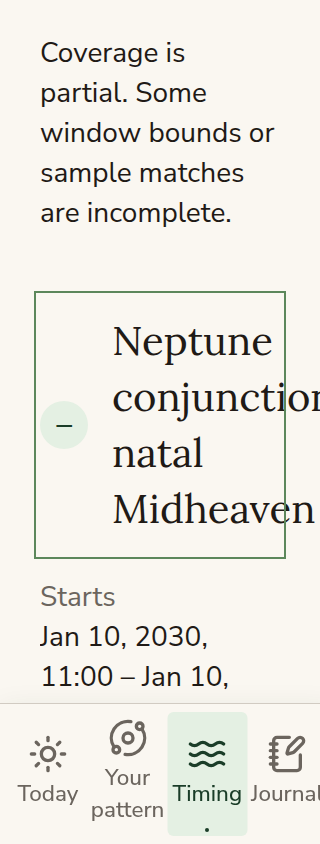
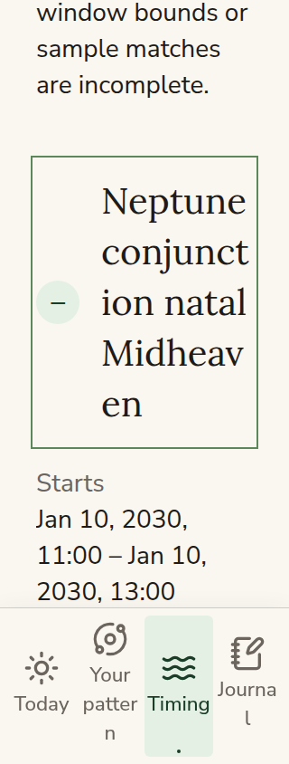

# Upcoming recovery and enlarged-text comparison

These captures use the real Timing route with synthetic local services and no
member data. They are review evidence, outside the application and public assets.

Both runs configured Chromium at 320 × 844 CSS pixels, enabled touch/mobile
emulation and reduced motion, and set the root font size to 200%. The window title
remained 40 px in both runs. The before capture uses main at `6e98a00`; the after
capture uses this change. Each capture scrolls the same expanded window into view.
Wrapping changes the scroll position and content height.

| Before                                                                                                | After                                                                                                         |
| ----------------------------------------------------------------------------------------------------- | ------------------------------------------------------------------------------------------------------------- |
|  |  |

Before, the document and layout viewport expanded to 335 px. The title's right
edge reached x=335 px while its disclosure ended at x=280 px. After, both widths
remain 320 px and the title fits within the disclosure. The full title, timing bounds, unknown
duration, uncertainty, and calculation record remain available through native
keyboard-operable disclosures. Filters and retry controls also wrap at this size
while retaining their 44 px minimum touch height.

## Reproduce the focused browser checks

Start the existing synthetic route fixture from the repository root:

```sh
PATTERN_MOBILE_UI_PORT=4276 node scripts/mobile-ui-fixture.mjs
```

Open `http://127.0.0.1:4276/timing` in a Playwright CLI session, then run
`tests/helpers/mobile-ui/upcoming-recovery.cases.txt` with its `run-code
--filename` option. The file is an async Playwright page function. It verifies the
fixture identity and refuses another origin. It writes captures under the ignored
`output/playwright/upcoming-recovery-20261021/` directory and returns structured
results; every result must pass. Changing the `stage` constant only changes
artifact filenames.

The 36 checks cover desktop (1440 × 1000), phone (390 × 844), and 200% text at
1440, 390, and 320 px. They exercise held requests, rapid filter changes, route
remounts, explicit retry, loading/failure announcements, keyboard order and focus,
partial results, transient refresh failures, unsupported calculations, stalled
transport deadlines, ignored late results, and reflow.
Request-queue and account-cache cancellation tests also run through `npm test`.

A dispatched browser call has a 60-second transport deadline, starting after its
queue wait. Filter cancellation does not release an active call early. The
deadline aborts its transport and restores explicit recovery even if a connection
does not settle. Browser abortion does not prove remote execution has stopped;
the service's existing limits and guards remain authoritative.

This evidence does not cover physical devices, screen-reader speech, native
browser zoom, or the live Swiss service. The fixture performs no live calculation,
member, billing, or model requests.
